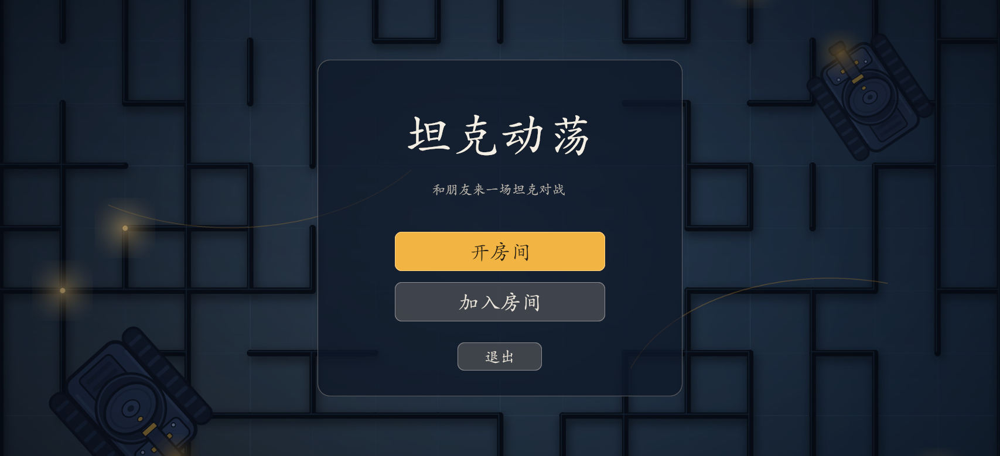
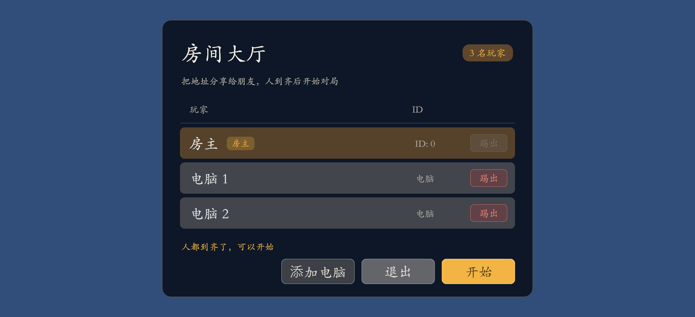
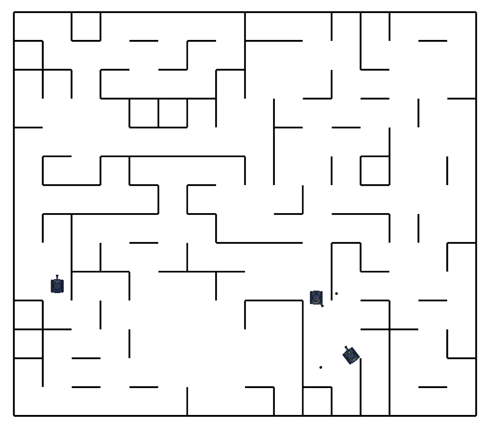
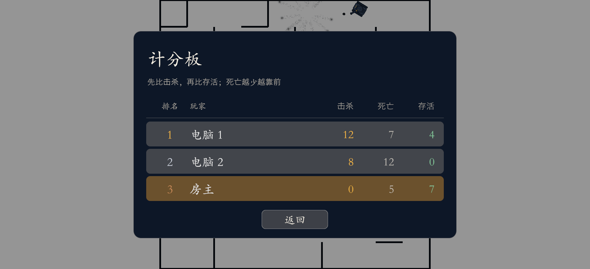

# 坦克动荡

> 开一间房，叫上朋友，在随机生成的迷宫里打一场会反弹的坦克大战。

**坦克动荡**是一款基于 Unity 的 2D 多人坦克对战游戏。房主开房间，朋友填入地址和端口就能加入；人不够，房主还能一键添加服务器控制的电脑玩家。每局开始，游戏会随机生成一张封闭的回廊迷宫，坦克在其中行驶、转动炮塔、发射会在墙壁之间反弹的炮弹。没有血量，一发命中即淘汰；最后活下来的那辆坦克，就是这一局的赢家。


## 📸 游戏画面

| 主菜单 | 房间大厅 |
| :---: | :---: |
|  |  |

| 战斗 | 计分板 |
| :---: | :---: |
|  |  |

## ✨ 亮点

| | |
| --- | --- |
| **会反弹的炮弹** | 子弹碰到墙会反射，而不是消失。它可能绕过走廊拐角命中对手，也可能在 30 秒后打中自己——站位和预判一样重要。 |
| **每局一张新地图** | 5×5 到 19×19 的随机回廊迷宫，四周完全封闭、出生点保证互相连通。开局前没人知道战场长什么样。 |
| **和朋友局域网直连** | 房主就是服务器，知道 IP 和端口就能开打，不需要专用服务器、账号或房间列表。 |
| **电脑玩家随时凑局** | 房主在大厅里一键添加。AI 完全跑在服务器上，会 A* 寻路、绕墙、瞄准，也会躲炮弹。 |
| **三种战绩** | 击杀、死亡、最终存活分开统计。苟到最后同样是本事。 |
| **为手感做的同步** | 移动采用“客户端本地立即响应 + 服务器定期校准”，操作跟手，各端画面也不会各走各的。 |

## 🗺️ 一局怎么玩

1. 房主开房间，朋友加入；房主在大厅里添加电脑、踢人。
2. 房主点 **开始**，清空战绩，随机生成地图和坦克。
3. 战斗中：开火消耗弹药，开火 30 秒后返还 1 发；炮弹会反弹，30 秒后消失；坦克被命中一次即淘汰。
4. 场上只剩 1 辆坦克时，本局结束，2 秒后自动生成新地图重开。
5. 计分板记录击杀、死亡和“最终存活”，只有房主点 **开始** 才会清零。

更完整的规则、数值和边界行为见 [玩法与规则](docs/gameplay.md)。

## 🎮 操作

| 按键 | 作用 |
| --- | --- |
| `W` / `↑` | 前进 |
| `S` / `↓` | 后退 |
| `A` / `←` | 车身左转 |
| `D` / `→` | 车身右转 |
| `,` / `.` | 炮塔左转 / 右转 |
| `空格` | 开火（初始 5 发弹药） |
| `Esc` | 打开 / 关闭大厅或计分板 |

## 🚀 快速开始

### 获取游戏

推送 `v*` 标签会自动构建 Windows 包并发布到 GitHub Release，可在 **[Releases](https://github.com/3297207993/tank/releases)** 页面下载最新构建。

### 从源码运行

1. 用 Unity Hub 打开本目录，编辑器版本选 **2022.3.34f1c1**。
2. 打开 `Assets/Scenes/start.unity`，点击 Play。
3. 点 **开房间**：进入 `Host` 场景，自动成为房主。
4. 再开一个编辑器实例。推荐用 ParrelSync：`Tools > ParrelSync > Clones Manager > Create New Clone`，在克隆出来的项目里也点 Play。
5. 第二个实例点 **加入房间**，地址填 `127.0.0.1`，端口留空（默认 7777），填名字，点 **确定**。
6. 房主在大厅里可以点 **添加电脑**；至少 2 名玩家后点 **开始**。

> 局域网联机时，客户端把 `127.0.0.1` 换成房主的内网 IP，并确保防火墙放行 UDP 7777。主机的监听地址在 `Host` 场景的 `NetworkManager > UnityTransport` 里配置。

构建和联调的更多细节见 [开发与调试](docs/development.md)，自动发布流程见 [发布新版本](docs/release.md)。

## 🛠️ 技术栈

| 项 | 版本 / 说明 |
| --- | --- |
| Unity | 2022.3.34f1c1 |
| 网络 | Netcode for GameObjects 1.15.0 + UnityTransport（UTP 1.x） |
| 网络拓扑 | 客户端-服务器；房主同时是服务器和本地客户端 |
| UI | UI Toolkit（UXML / USS）：主菜单、大厅、计分板 |
| 物理 | 2D 物理：Rigidbody2D、Collider2D、反弹物理材质 |
| 多开调试 | ParrelSync（已放在 `Assets/ParrelSync`） |
| 美术工具 | Python + Pillow（`Tools/tank_art`） |

## 📁 目录结构

```text
Assets/
  Scenes/                  start、Host、Client 三个场景
  control/                 入口、连接、大厅、计分板（UI Toolkit + 控制逻辑）
    Network/               房主启动、服务器地址解析
    StartScene/            主菜单
    HostConnectionView/    大厅：玩家列表、踢人、添加电脑、开始
    ClientConnection/      客户端连接表单
    ScoreTable/            计分板
    HostViewManager/       游戏内顶部按钮（UGUI）
    style/                 公共 USS 主题
  game_obj/
    tank/                  坦克控制、预制体、贴图
    bullet/                子弹控制器与预制体
    map/                   地图生成、路障预制体
    ai/                    电脑玩家决策与 A* 导航
    CustomComponents/      FixedNetworkTransform（自研同步组件）
    common/                通用小脚本
  ParrelSync/              多开调试工具
Tools/tank_art/            坦克贴图生成脚本（Python）
docs/                      项目文档
```

## 📚 文档

- [架构总览](docs/architecture.md)
- [网络与同步](docs/network.md)
- [玩法与规则](docs/gameplay.md)
- [地图生成](docs/map-generation.md)
- [电脑玩家 AI](docs/ai.md)
- [界面结构](docs/ui.md)
- [开发与调试](docs/development.md)
- [发布新版本](docs/release.md)
- [坦克贴图工具](Tools/tank_art/README.md)

## ⚠️ 已知限制

项目仍处于早期阶段（`v0.0.1`），下面是当前已知的边界：

- 没有房间列表或自动发现：客户端必须知道房主的地址和端口。
- 没有断线重连；房主退出会直接结束对局。
- 移动采用“客户端本地先应用、再上报服务器转发”的方式，不是严格服务器权威的反作弊移动。
- 目前只按 Windows 平台配置和验证。

欢迎提 Issue 或 PR。开发约定和手动回归清单见 [开发与调试](docs/development.md#代码约定)。
