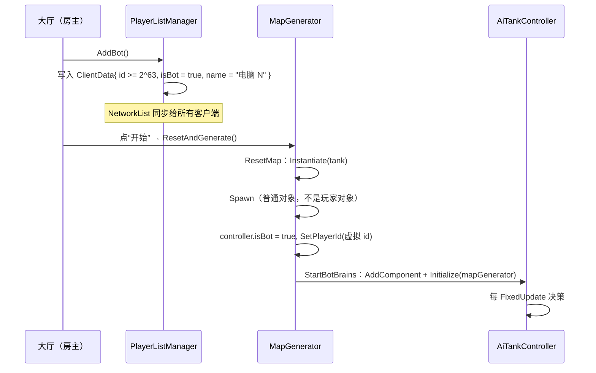
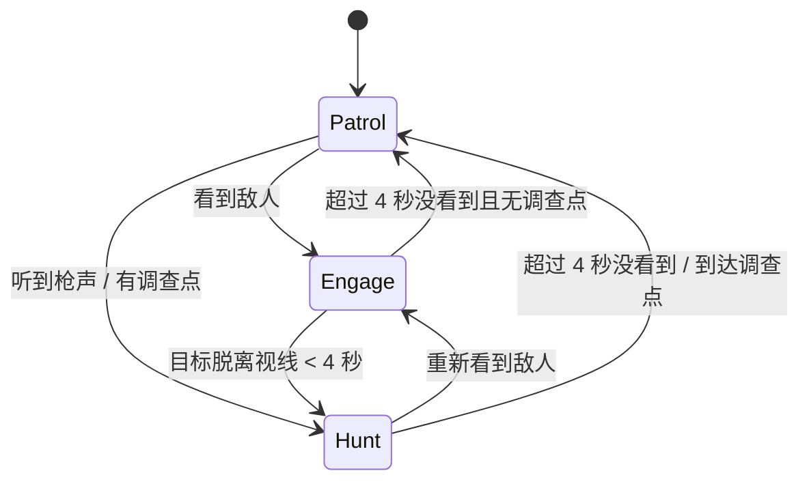
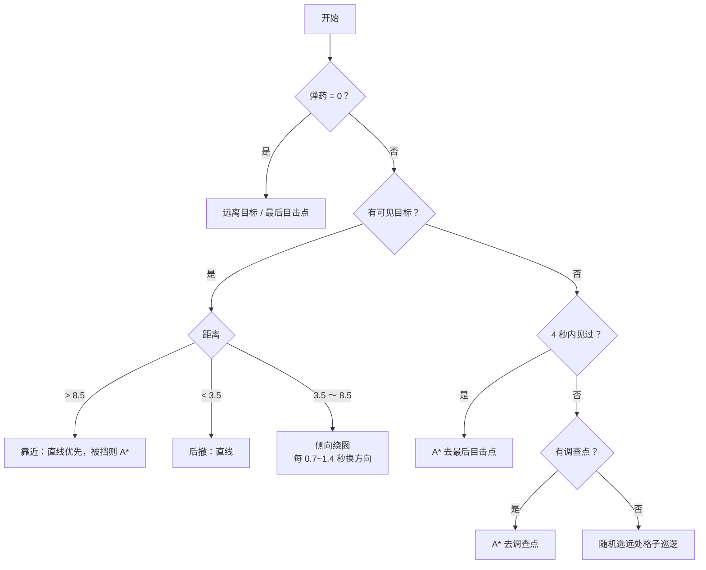
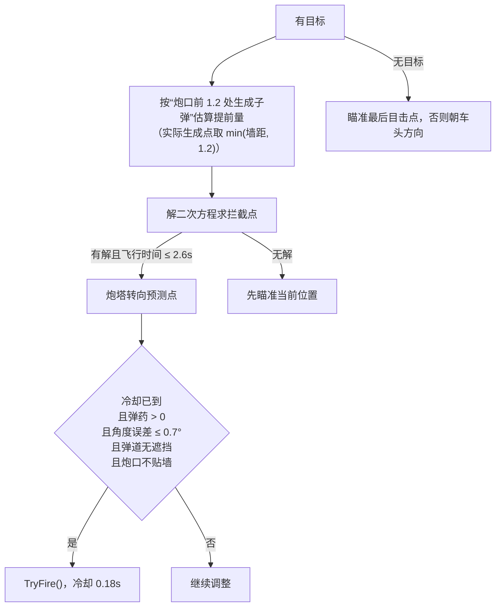

# 电脑玩家 AI

电脑玩家完全跑在服务器上：感知、决策、寻路、瞄准、开火都由服务器计算，再把结果通过普通的 `NetworkVariable` / RPC 同步给客户端。它不是一个网络连接，因此不需要为它做任何作弊防护或输入校验。

代码位置：

- `Assets/game_obj/ai/AiTankController.cs`：感知、状态机、移动、瞄准、躲子弹。
- `Assets/game_obj/ai/AiNavigation.cs`：基于地图格子数据的 A* 寻路。

## 生命周期



关键点：

- 电脑坦克用 `NetworkObject.Spawn(true)`，而不是 `SpawnAsPlayerObject`，因为服务器上没有对应的 `NetworkClient`。
- `TankController` 在 `Update` / `FixedUpdate` 里对 `isBot` 直接 return，所以不会去读人类输入。
- AI 直接调用服务器端的 `ApplyDrive`、`AimTurretTowards`、`TryFire`，不经过 RPC。
- 移除电脑玩家时，`ConnectionViewManager.RemoveBotTank` 先按 `playerId` 找到并 Despawn 坦克，再让 `PlayerListManager.RemoveBot` 删列表项。

## 行为状态机



| 状态 | 含义 | 行为 |
| --- | --- | --- |
| `Patrol` | 没有目标，也没有近期记忆 | 随机挑一个远处的格子巡逻 |
| `Hunt` | 目标刚消失（4 秒内），或听到了枪声 | 前往最后目击点 / 枪声来源 |
| `Engage` | 有可见目标 | 保持距离、侧向绕圈、预判射击、躲子弹 |

## 感知

每 0.08 秒扫描一次：

1. 遍历所有 `Tag == "Tank"` 的对象，跳过自己、跳过未 Spawn 的。
2. 按距离从近到远，找第一个“有视线”的目标。
3. 视线检测：从自己的位置向候选坦克做 `Physics2D.RaycastAll`，忽略自己、子物体和子弹；第一个真正的遮挡物必须是那辆坦克。
4. 找到目标：
   - 状态切到 `Engage`。
   - 记录目标位置，并用两次采样的差值估算速度（`Lerp` 平滑 0.65，异常值限制在 6 单位/秒内）。
   - 更新 `lastSeenPosition` / `lastSeenTime`。
5. 没找到：
   - 4 秒内见过 → `Hunt`，否则 `Patrol`。

### 听枪声

AI 在服务器上能看到所有子弹。如果：

- 当前没有目标，
- 已经超过 4 秒没看到敌人，
- 附近 20 单位内有一颗**别人打的**子弹，

它会把“子弹当前位置沿飞行方向往回退 6 单位”作为调查点，前往查看。这让 AI 不会在敌人绕后时一直傻站着。

## 躲子弹

每 0.06 秒检查一次：

1. 遍历场上所有子弹，只看 22 单位内、速度 > 0.5 的。
2. 对每颗子弹做短时模拟：
   - 以 0.07 秒为步长，最多模拟 1.15 秒；
   - 用半径 0.16 的 `CircleCast` 检测路径，碰到墙就反射，最多反射 5 次；
   - 如果子弹路径会进入自己 0.9 单位内，且子弹是朝自己飞的，标记为威胁。
3. 取最早命中的那颗，向它的垂直方向闪避 0.3 秒。
4. 如果垂直方向被墙挡住，就试反方向；两边都不行就放弃。

## 移动决策

每帧按优先级决定方向：



- 所有“直线优先”的判断都用 `CanMove()`：以 0.75 半径、0.7 距离做 `CircleCast`，被墙挡住就改用 A*。
- 侧向绕圈让炮塔可以独立瞄准，同时让对手更难预判。
- 没有目标时，巡逻点从 24 个随机格子里选离自己最远的一个。

## 驾驶

`DriveToward(direction)` 用目标方向与车身朝向的夹角：

| 夹角 | 油门 |
| --- | --- |
| < 45° | 1.0 |
| 45° ~ 95° | 0.5 |
| ≥ 95° | 0（原地转向） |

转向量：`Clamp(夹角 / 12, -1, 1)`。也就是说大角度时几乎满舵，接近对齐时自动收敛。

## 瞄准与开火



### 拦截解算

已知：

- 子弹速度 `s = 6`
- 目标相对炮口位置 `d`
- 目标速度 `v`

求 `t` 使 `|d + v·t| = s·t`，化为：

```text
a = v·v - s²
b = 2·d·v
c = d·d
t = 最小的正根
```

然后瞄准 `targetPos + v·t`。

实现细节：

- 提前量从 **子弹实际生成点**（炮口前 1.2）算，而不是炮口，否则目标横移时会打偏。
- 飞行时间超过 2.6 秒就不开火，先靠近。
- 开火前检查 `IsShotPathClear`：从炮口到预测点做射线，预留 0.6 的目标半径；第一个遮挡物必须是目标。
- 开火前检查 `MuzzleSafe`：炮口 1.8 范围内如果有墙且距离 < 1.45，就不开火。否则子弹可能生成在墙边，反弹回来打到自己。

## A* 导航

`AiNavigation.Repath(from, to, clear)`：

- 直接读 `MapGenerator.CurrentMap` 的格子数据（不是物理碰撞体）。
- 四方向移动，邻居之间没有墙才可走。
- 启发函数是曼哈顿距离。
- 开放列表用线性扫描找最小 `f`；在地图最大 19×19 的规模下够用。
- 目标不可达时，走到“离目标最近”的那个格子。
- 可选的 `clear` 回调做拉直：从路径末端往回找最远的可直达点，删掉中间多余的格子。AI 传入的是 `IsClearForTank`：以 0.95 半径做 `CircleCast`，忽略自己和子弹。

重规划频率：每 0.35 秒一次；如果目标点移动超过 `sqrt(1.5)`（约 1.22 单位）也立即重规划。

## 卡住恢复

每 0.5 秒检查一次：

- 如果“想动”但实际位移 < 0.2，且不在恢复期：
  - 清空路径和巡逻点；
  - 随机选一个方向闪避 0.45 秒；
  - 0.45 秒内不再重复触发。

## 调参速查

| 常量 | 值 | 作用 |
| --- | --- | --- |
| `PerceptionInterval` | 0.08s | 感知频率 |
| `PathInterval` | 0.35s | 重寻路频率 |
| `DodgeCheckInterval` | 0.06s | 躲子弹检测频率 |
| `DodgeHorizon` | 1.15s | 子弹模拟时长 |
| `DodgeStep` | 0.07s | 子弹模拟步长 |
| `PreferredMinRange` | 3.5 | 太近就后撤 |
| `PreferredMaxRange` | 8.5 | 太远就靠近 |
| `FireCooldown` | 0.18s | 开火间隔 |
| `AimTolerance` | 0.7° | 允许开火的角度误差 |
| `MaxInterceptTime` | 2.6s | 超过就不预判射击 |
| `MemoryDuration` | 4s | 目标记忆时长 |
| `TankRadius` | 0.75 | 移动探测半径 |
| `PathClearance` | 0.95 | 路径拉直探测半径 |
| `MoveProbe` | 0.7 | 直线移动探测距离 |
| `BulletSpawnOffset` | 1.2 | 子弹生成点偏移 |

## 强度与成本

AI 的“强”来自：

- 瞬时反应（0.08 秒感知）；
- 零瞄准误差 + 完整提前量；
- 服务器视角，能看到所有子弹并模拟反弹。

它仍然受这些限制：

- 炮塔转速 180°/秒；
- 只能打有视线的目标；
- 弹药 5 发、30 秒才回 1 发；
- 子弹有飞行时间；
- 炮口贴墙时不开火；
- 寻路和移动检测会被墙挡住。

成本方面，每个电脑玩家每 0.08 秒都会 `FindGameObjectsWithTag` 并对每个候选做射线；每 0.06 秒模拟附近所有子弹。电脑玩家数量多时这些开销会线性增长，建议控制在个位数。

## 调试

- 运行中在 Scene 视图可以看到 Gizmos：黄色折线是当前路径，红色线指向当前目标（`Engage` 状态路径也是红色）。
- 开局时服务器会打印 `[AI] 电脑玩家 N 已开始行动`。
- AI 只在服务器运行；客户端看不到 Gizmos，也不会执行决策。
