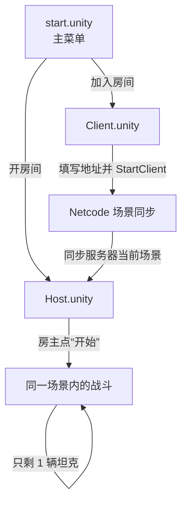
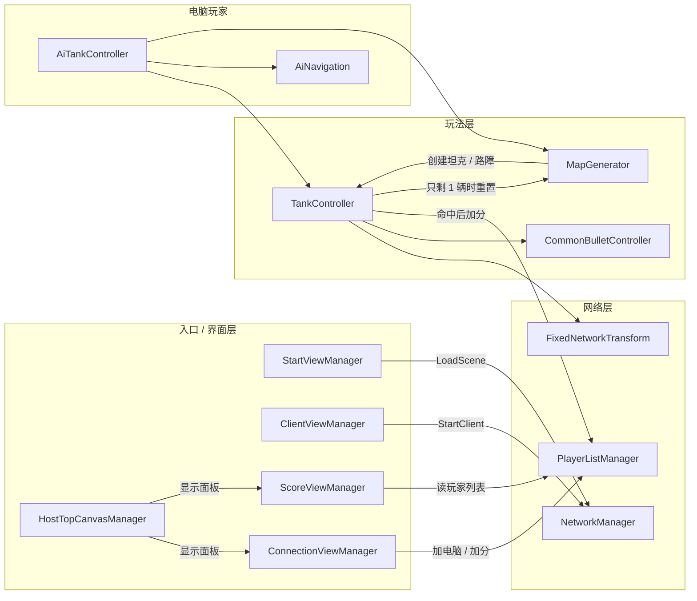
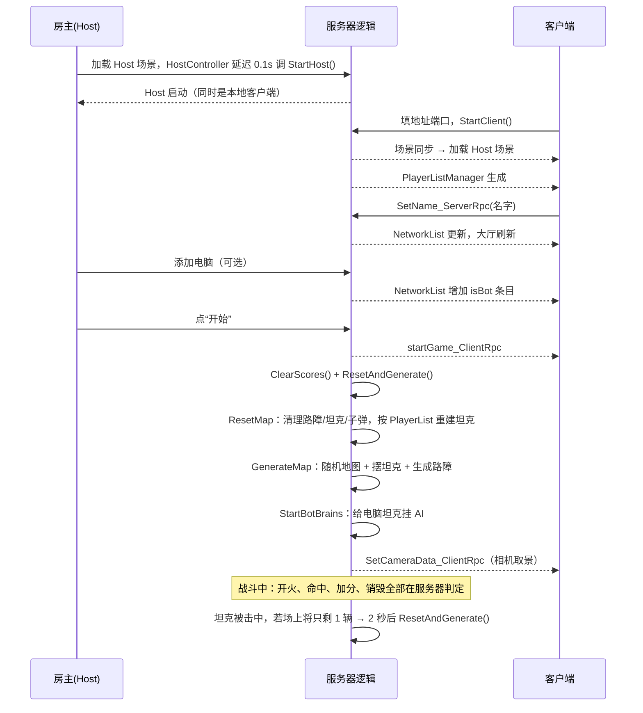

# 架构总览

## 一句话

三个场景（主菜单 / 房主 / 客户端）、一套 Netcode 客户端-服务器模型、两类参与者（真人玩家和服务器端电脑玩家）。所有战斗判定都在服务器上完成，客户端负责输入、本地预测和表现。

## 场景与启动流程



| 场景 | 作用 | 关键对象 |
| --- | --- | --- |
| `start.unity` | 主菜单 | `StartView`（UIDocument）、`StartViewManager`、`StartSceneControler` |
| `Host.unity` | 房主 + 服务器；也是联机后的通用游戏场景 | `NetworkManager`、`MapManager`、`PlayerListManager`、`ConnectionView`、`ScoreView`、`Canvas`、`MapContainer`、`NetworkLifeTimeHolder` |
| `Client.unity` | 连接前的表单 | `NetWorkManager`、`main`（UIDocument + `ClientViewManager`） |

关键点：`NetworkManager` 的 `EnableSceneManagement` 是开启的。客户端连接成功后，Netcode 会把服务器当前所在的 `Host` 场景同步到客户端，所以：

- `PlayerListManager`、大厅、计分板这些只放在 `Host` 场景里的对象，客户端也有一份。
- `Client` 场景只负责“连接前”的地址表单；连上之后，界面和玩法对象都来自同步过来的 `Host` 场景。
- `HostController` 在客户端也会随场景加载而运行，但它用 `if (!NetworkManager.Singleton.IsClient) StartHost()` 做了守卫，不会重复开房。

## Host 场景对象职责

| 对象 | 组件 / 脚本 | 职责 |
| --- | --- | --- |
| `NetworkManager` | `NetworkManager` + `UnityTransport` | 网络单例、传输、预制体注册；`DontDestroyOnLoad` |
| `MapManager` | `NetworkObject` + `MapGenerator` | 随机地图生成、坦克/路障/子弹的清理与重新生成、相机取景 |
| `PlayerListManager` | `NetworkObject` + `PlayerListManager` | 维护 `NetworkList<ClientData>`（名字、分数、是否电脑）、加分、加/删电脑 |
| `ConnectionView` | `UIDocument` + `NetworkObject` + `ConnectionViewManager` | 大厅：玩家列表、踢人、添加电脑、开始游戏 |
| `ScoreView` | `UIDocument` + `ScoreViewManager` | 计分板：按分数排序、名次高亮 |
| `Canvas` | UGUI + `HostTopCanvasManager` | 游戏内顶部两个按钮（用户列表 / 计分板），按钮事件在场景里通过 `OnClick` 绑定 |
| `MapContainer` | `NetworkObject` + `NetworkTransform` | 所有路障的父节点，重置地图时整体清理 |
| `NetworkLifeTimeHolder` | `HostController` | 延迟 0.1 秒调用 `StartHost()`；销毁时关闭并销毁 `NetworkManager` |

## 坦克预制体结构

```text
tank（Tag: Tank）
├─ NetworkObject
├─ TankController
├─ FixedNetworkTransform       自研，同步整个车身的位移/旋转
├─ Rigidbody2D
├─ BoxCollider2D               1.3 × 1.5
├─ 坦克机身                     SpriteRenderer，车头朝下（旋转 180°）
└─ 旋转轴
   ├─ NetworkTransform         官方组件，只同步旋转
   └─ 炮塔                     SpriteRenderer，炮管朝左（旋转 -90°）
```

几个容易踩的点：

- `TankController.turret` 指向的是 **旋转轴**（炮塔的父节点），不是炮塔本身；旋转轴上的 `NetworkTransform` 负责同步旋转，炮塔作为子物体跟着转，`NetworkVariable<float> turretAngle` 负责中途加入时的朝向兜底。
- 车身根节点用的是自研 `FixedNetworkTransform`，不是官方 `NetworkTransform`。
- 子弹、路障、`MapContainer`、旋转轴用的是官方 `NetworkTransform`。

## 代码分层



## 一局的运行时序



## 数据所有权

| 数据 | 谁写 | 谁读 | 说明 |
| --- | --- | --- | --- |
| 坦克位置 / 朝向 | 客户端预测，服务器转发 | 所有客户端 | `FixedNetworkTransform` |
| 炮塔角度 | 服务器 | 所有客户端 | `NetworkVariable<float> turretAngle`，初始 270 |
| 弹药数 | 服务器 | 所有客户端 | `NetworkVariable<int> bulletCount`，初始 5 |
| 玩家列表 / 分数 | 服务器 | 所有客户端 | `NetworkList<ClientData>` |
| 地图格子数据 | 服务器 | 仅服务器（AI 用） | `MapGenerator.CurrentMap`；客户端只看到同步出来的路障 |
| 子弹 | 服务器生成 | 所有客户端 | 子弹是 `NetworkObject`，物理表现各端本地跑 |

## 关键设计决策

1. **自研 `FixedNetworkTransform`，没用官方 `NetworkTransform`**
   需要“客户端立刻响应输入 + 服务器定期校准”的手感。客户端把每次位移/旋转当成一个不可靠 RPC 发给服务器，同时本地先应用；服务器按 20 Hz 广播权威快照，客户端把尚未被快照确认的本地增量重新叠回去。细节见 [network.md](network.md#fixednetworktransform)。

2. **电脑玩家是“虚拟客户端”**
   电脑玩家没有真实连接，用高位 id（`1UL << 63` 起）混在 `PlayerList` 里。服务器直接 `Spawn` 一辆非玩家对象的坦克，再挂 `AiTankController`。这样计分、列表、踢人逻辑对真人和电脑可以共用。

3. **战斗判定服务器权威**
   开火、子弹生成、命中、加分、销毁坦克都只在服务器执行。客户端只发“我想开火”的请求。

4. **Host 场景同时是客户端的游戏场景**
   利用 Netcode 的场景同步，客户端连上后直接进入 Host 场景，省去“游戏场景再同步一次”的复杂度。

5. **UI Toolkit + ListView 复用**
   大厅和计分板都用 `ListView`，`makeItem` 只注册一次回调，`bindItem` 负责把当前数据写进复用的元素。相关约定见 [ui.md](ui.md)。

## 建议阅读顺序

1. 先看 [gameplay.md](gameplay.md) 了解一局怎么进行。
2. 再看 [network.md](network.md) 理解同步和 RPC。
3. 然后按兴趣看 [map-generation.md](map-generation.md)、[ai.md](ai.md)、[ui.md](ui.md)。
4. 要跑起来或改代码，看 [development.md](development.md)。
