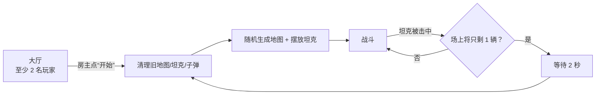

# 玩法与规则

## 目标

在一张随机生成的回廊地图里用反弹的炮弹击中其他坦克。每次击中得 1 分，分数累计；场上只剩 1 辆坦克时本局结束，2 秒后自动重开一局。

## 一局流程

- 大厅阶段只能加电脑、踢人、看分数，不能移动坦克。
- 点“开始”会清空所有分数，然后重开一局。
- 中途按 `Esc` 可以打开大厅；房主再点一次“开始”会立刻重开并清分（当前实现没有禁止中途重开）。

## 操作

| 按键 | 作用 |
| --- | --- |
| `W` / `↑` | 前进 |
| `S` / `↓` | 后退 |
| `A` / `←` | 车身左转 |
| `D` / `→` | 车身右转 |
| `,` | 炮塔左转 |
| `.` | 炮塔右转 |
| `空格` | 开火 |
| `Esc` | 打开 / 关闭大厅或计分板 |

## 数值一览

| 项 | 数值 | 出处 |
| --- | --- | --- |
| 车身前进/后退速度 | 5 单位/秒 | `TankController.ApplyDrive` |
| 车身转向速度 | 180°/秒 | `TankController.ApplyDrive` |
| 炮塔转向速度 | 180°/秒 | `TankController.ApplyTurret` |
| 初始弹药 | 5 发 | `bulletCount = new(5)` |
| 弹药恢复 | 开火 30 秒后 +1 发 | `CommonBulletController.bulletLifeTime` |
| 子弹速度 | 6 单位/秒 | `CommonBulletController.bulletSpeed` |
| 子弹寿命 | 30 秒 | 同上 |
| 子弹生成距离 | 炮口前最多 1.2 单位 | `TankController.TryFire` |
| 地图格边长 | 3 单位 | `MapGenerator.mapScale` |
| 坦克碰撞体 | 1.3 × 1.5 | `tank.prefab` |
| 一局结束延迟 | 2 秒 | `ResetAndGenerateLater(2.0f)` |
| 每次命中得分 | 1 | `PlayerListManager.AddScore` |

## 驾驶与炮塔

- 车身和炮塔是分开转的：`A/D` 转车身，`,`/`.` 转炮塔。炮塔角度会通过 `NetworkVariable<float> turretAngle` 同步给其他客户端。
- 车身移动走自研 `FixedNetworkTransform`：本地先动，再把增量上报服务器；服务器定期广播快照校准。详见 [network.md](network.md#fixednetworktransform)。
- 炮塔的本地角度由服务器写入 `turretAngle`。服务器每 0.25 秒兜底同步一次，保证中途加入的客户端也能拿到正确朝向。

## 开火

只有服务器能真正生成子弹：

1. 本地玩家按空格，如果弹药 > 0，发 `fire_ServerRpc()`。
2. 服务器检查 `IsServer && IsSpawned && 弹药 > 0`。
3. 从炮塔位置沿炮管方向做一次 2D 射线，取最近命中距离，生成点取 `min(距离, 1.2)`。地图边缘是封闭的，所以射线总能打到墙，不会出现“没有命中”的情况。
4. 在生成点实例化子弹，旋转与炮塔一致，记录射手 `playerId`，`Spawn(true)`。
5. 弹药 -1；30 秒后 `+1`（`Invoke(bulletCountAdd, bulletLifeTime)`）。
6. 子弹在 `Start` 里给自己加一个向上的冲量（速度 6），并在 30 秒后自毁。

> 子弹在服务器生成，但物理表现（飞行、反弹）由各端的 `Rigidbody2D` 本地模拟。命中判定也只在服务器算。

## 子弹与反弹

- 子弹带 `CircleCollider2D`（半径 0.15）和反弹物理材质，碰到墙会反射，不会消失。
- 碰到 **坦克**（Tag `Tank`）时，子弹自毁。
- 30 秒寿命到了也会自毁，并给射手返还 1 发弹药。
- 子弹可以打中自己或队友，但自己打中自己不加分。

## 命中、得分与淘汰

命中发生在服务器：

1. 坦克的 `OnCollisionEnter2D` 检测到 `Tag == "Bullet"`。
2. 如果射手不是自己、也不是“无主”（`ulong.MaxValue`），给射手加 1 分。
3. 在所有客户端播放爆炸特效（`showDestroyEffect_ClientRpc`）。
4. Despawn 被击中的坦克。
5. 如果此时场上（Despawn 前）坦克数量 ≤ 2，说明这一击之后只剩 1 辆，调用 `ResetAndGenerateLater(2.0f)`。

补充：

- 坦克没有血量，一发命中就淘汰。
- 被淘汰的玩家不会复活，保持连接和大厅/计分板权限，等下一局开始。
- 分数在同一局内累计；只有房主点“开始”才会清零。

## 弹药

- 每辆坦克独立维护 `NetworkVariable<int> bulletCount`，初始 5。
- 每次开火 -1。
- 每次开火后 30 秒 +1，因此理论上会在一段时间后回到 5 发（如果期间没死）。
- 坦克被击毁后弹药随对象销毁；新一局重新生成坦克时恢复为 5。

## 电脑玩家

- 只能由房主在大厅里添加；默认 0 个，也可以通过 `PlayerListManager` 的 `botCount` 预置。
- 电脑玩家混在玩家列表里，有虚拟 id 和名字（“电脑 N”），计分规则与真人相同。
- 开局时服务器直接生成一辆非玩家对象的坦克，再挂上 `AiTankController`；AI 只在服务器运行。详见 [ai.md](ai.md)。
- 电脑玩家只能在大厅里移除；开局后“添加电脑”按钮隐藏。

## 回合重置做了什么

`MapGenerator.ResetAndGenerate()`：

1. 清空 `spawnedBots` 列表和地图数据 `CurrentMap`。
2. Despawn `MapContainer` 下所有路障。
3. Despawn 所有 Tag 为 `Tank` 的坦克。
4. Despawn 所有 Tag 为 `Bullet` 的子弹。
5. 按 `PlayerList` 重新生成坦克：真人用 `SpawnAsPlayerObject`，电脑用普通 `Spawn` 并标记 `isBot`。
6. 生成新地图（随机尺寸、保证连通、封闭边缘）。
7. 给所有电脑坦克挂 AI 并初始化。
8. 通过 `ClientRpc` 调整相机。

分数在这个过程里不会重置；重置分数只发生在房主点“开始”时。

## 边界行为

- 子弹可以在墙之间反复弹射，30 秒内都可能命中。
- 两辆坦克相撞是物理碰撞，不会造成伤害。
- 玩家断开连接时，服务器会回收他的坦克；如果因此只剩 1 辆，下一帧不会自动重开（重开判定只在“被子弹击中”时触发），需要等下一次命中或房主重开。
- 房主也可以被击中淘汰；服务器和网络会继续运行，只是房主自己处于观战状态。
