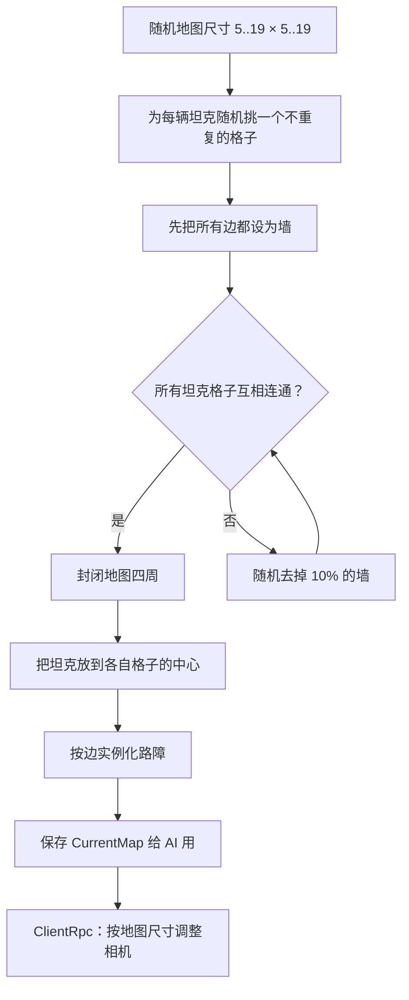

# 地图生成

地图是一个 `x × y` 的格子迷宫，每格 3 个世界单位。生成目标是：随机、但保证所有坦克出生点互相连通，并且地图四周完全封闭。

代码位置：`Assets/game_obj/map/MapGenerator.cs`（`MapGenerator` + `MapDataContainer`）。

## 坐标系

```text
世界坐标
  ^ y
  |
  |   ┌─────┬─────┬─────┐
  |   │(0,2)│(1,2)│(2,2)│
  |   ├─────┼─────┼─────┤
  |   │(0,1)│(1,1)│(2,1)│
  |   ├─────┼─────┼─────┤
  |   │(0,0)│(1,0)│(2,0)│
  |   └─────┴─────┴─────┘───> x
```

- 格子 `(x, y)` 的中心：`((x + 0.5) * 3, (y + 0.5) * 3)`，对应 `CellCenter()`。
- 世界坐标转格子：`floor(world / 3)`，再 clamp 到 `[0, xCount-1] / [0, yCount-1]`，对应 `WorldToCell()`。
- 地图尺寸：`Random.Range(5, 20)`，即 **5 到 19**，x 和 y 独立随机。

## 数据结构：墙存在“边”上

`MapDataContainer` 不是 `bool[x][y]` 的格子数组，而是按 **边** 存墙。这样相邻两格共享一堵墙时只存一份。

```text
data 的索引：
  data[2x]     ：第 x 条竖边（单元格 (x-1,y) 和 (x,y) 之间），长度 yCount
  data[2x + 1] ：第 x 列的横边（单元格 (x,y-1) 和 (x,y) 之间），长度 yCount + 1

           data[2x]        data[2x+2]
             │                │
     ── data[2x+1][y+1] ──────┼──────   ← (x,y) 的上边
             │      (x,y)     │
     ── data[2x+1][y] ────────┼──────   ← (x,y) 的下边
             │                │
```

四个方向的取值：

| 方向 | 访问 |
| --- | --- |
| `Up` | `data[x*2 + 1][y + 1]` |
| `Down` | `data[x*2 + 1][y]` |
| `Left` | `data[x*2][y]` |
| `Right` | `data[x*2 + 2][y]` |

因此：

- `GetData((x,y), Up)` 和 `GetData((x,y+1), Down)` 是同一块内存。
- 墙是双向的：`Left` 就是左边格子的 `Right`。

`true` 表示有墙，`false` 表示可通行。

## 生成算法



### 1. 坦克出生点

为每辆坦克随机选格子，用 `tankPos.Contains` 避免重复。坦克数量远小于格子数，所以这个做法足够。

### 2. 连通性保证

初始时所有边都是墙，地图被切成一个个孤立的格子。然后反复执行：

- 用 BFS 检查 `tankPos[0]` 能否走到其他每个坦克位置（`MapDataContainer.isConnected`）。
- 只要有一个走不到，就把当前所有墙按 10% 概率随机删掉，再检查。

因为地图四周还没封，BFS 只在格子内部走；墙越来越少，最终一定全连通。

### 3. 封闭边缘

连通之后，把四条外边全部设为墙：

- 底边：每列的 `Down`
- 顶边：每列的 `Up`
- 左边：每行的 `Left`
- 右边：每行的 `Right`

这一步保证坦克不会跑出地图，也保证子弹射线总能打到墙。

### 4. 摆放坦克

把每辆坦克的 `transform.position` 设为对应格子的中心。

### 5. 实例化路障

路障预制体是 `roadblock.prefab`：一根 0.2 × 3 的碰撞体，正好是一格的长度。生成时只需要处理“下边”和“左边”，因为上边/右边由相邻格子的下边/左边共享：

| 边 | 生成位置 | 旋转 |
| --- | --- | --- |
| 单元格 `(i,j)` 的 `Down` | `(i*3 + 1.5, j*3)` | z = 90°（横墙） |
| 单元格 `(i,j)` 的 `Left` | `(i*3, j*3 + 1.5)` | 0°（竖墙） |
| 顶行 `(i, yCount-1)` 的 `Up` | `(i*3 + 1.5, yCount*3)` | z = 90° |
| 最右列 `(xCount-1, j)` 的 `Right` | `(xCount*3, j*3 + 1.5)` | 0° |

所有路障都挂在 `MapContainer` 下，作为 `NetworkObject` 生成，客户端会看到同样的布局。

### 6. 保存地图数据

`CurrentMap = mapData`。这份数据只在服务器保留，电脑玩家的 A* 导航直接读它；客户端不参与寻路。

### 7. 相机取景

```csharp
Camera.main.transform.position = new Vector3(width / 2, height / 2, -10);
Camera.main.orthographicSize =
    Mathf.Max(width / aspect, height) / 2f;
```

地图尺寸变化后，通过 `SetCameraData_ClientRpc` 在两端同时调整。

## 重置地图

`ResetMap()` 会：

1. 清空 `CurrentMap` 和 `spawnedBots`。
2. Despawn `MapContainer` 下所有路障。
3. Despawn 所有 `Tank` 和 `Bullet`。
4. 按 `PlayerList` 重建坦克（真人 / 电脑分别处理）。

`ResetAndGenerate()` = `ResetMap()` + `GenerateMap()` + `StartBotBrains()`。
`ResetAndGenerateLater(delay)` 会先取消上一次预约，再延迟调用。

## 设计特点与限制

- **连通性只保证出生点互通**，不保证地图有回路或“好玩”。10% 的删墙策略可能把地图删得比较开阔。
- **每次删 10%** 是以“当前所有墙”为基数，地图越小，几轮就能全通。
- **没有种子**：`UnityEngine.Random` 没有显式播种，无法复现同一张地图。
- **尺寸上限 19×19**，对应 57 × 57 世界单位；相机按长边取景。
- `MapDataContainer` 的公开方法没有做边界检查，调用方必须保证坐标合法（`WorldToCell` 会 clamp）。
