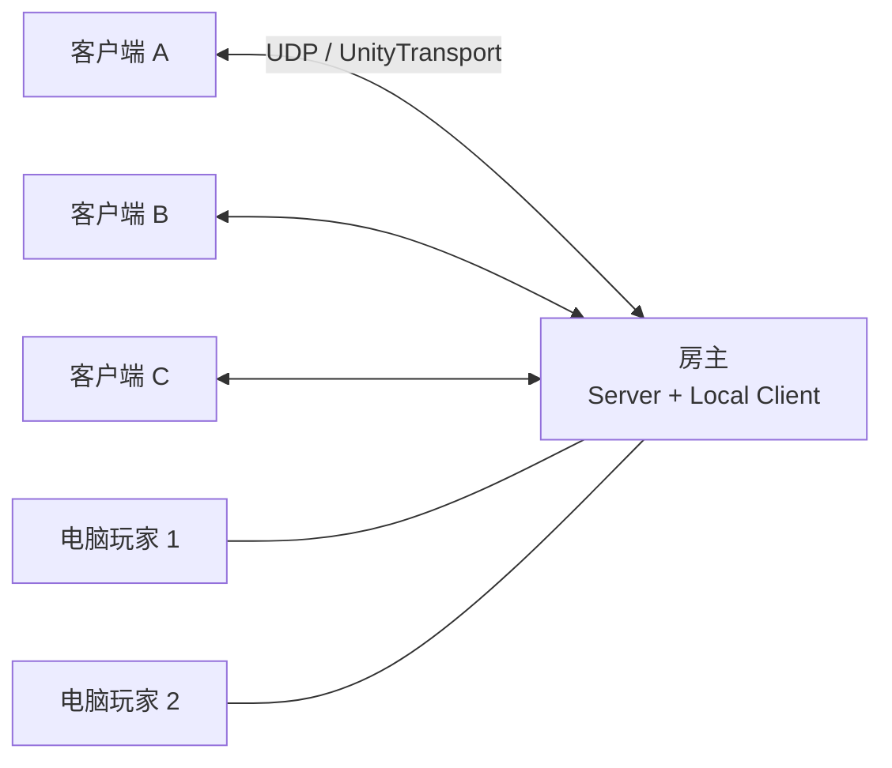
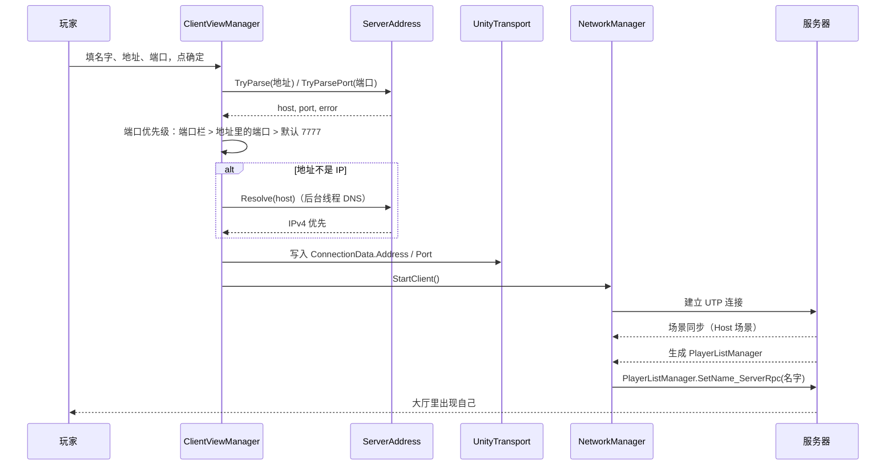
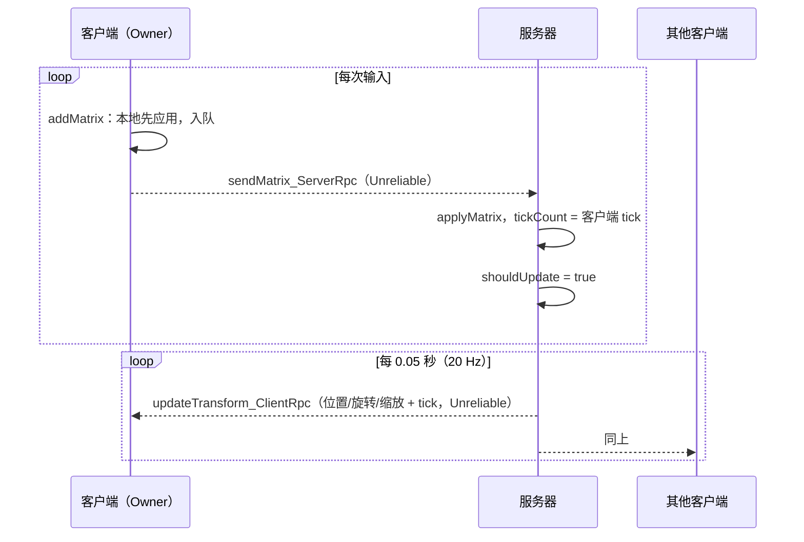
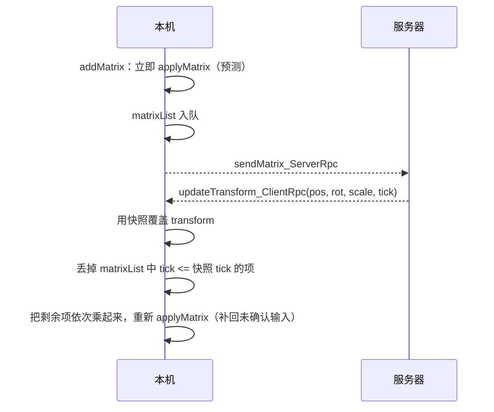

# 网络与同步

## 拓扑

采用 Netcode for GameObjects 的客户端-服务器模型。房主是服务器，同时也是本地客户端；其他玩家是纯客户端。没有中继服务器，客户端直连房主。



电脑玩家不是网络连接，只是服务器上的一辆坦克 + 一个 AI 组件，所以图中的连线只表示逻辑归属。

## NetworkManager 配置

| 配置项 | 值 | 说明 |
| --- | --- | --- |
| Tick Rate | 30 | 固定网络帧 |
| Connection Approval | 关闭 | 不校验连接，任何人知道地址即可加入 |
| Enable Scene Management | 开启 | 客户端连上后同步服务器的 `Host` 场景 |
| Force Same Prefabs | 开启 | 两端预制体列表必须一致 |
| Recycle Network Ids | 开启（延迟 120s） | 断线后回收 id |
| Run In Background | 开启 | 失去焦点时继续联网 |
| Player Prefab | `tank.prefab` | 真人玩家对象 |
| Network Prefabs | `DefaultNetworkPrefabs.asset` | 坦克、路障、子弹等 |
| Transport | UnityTransport | UTP 1.x |

传输层参数（`Host` 场景）：监听 `0.0.0.0:7777`；最大负载 6144 字节；心跳 500ms；连接超时 1s；最多尝试 60 次；断线判定 30s。`Client` 场景默认连 `127.0.0.1:7777`。

> `DefaultNetworkPrefabs.asset` 里有 4 个条目，其中一个 guid 在当前 `Assets` 中找不到对应预制体（历史遗留），不影响运行，但新增网络预制体时建议顺手清理。

## 连接流程



要点：

- UTP 1.x 不会自己解析域名，所以 `ClientViewManager` 先在后台线程 `Dns.GetHostAddresses`，优先取 IPv4。
- 地址栏支持直接粘贴 `http://example.com:7788/path`、`ws://host`、`[::1]:7788` 这类写法，协议头和路径会被丢弃。
- 端口栏留空时用地址里写的端口；再没有就用场景里 `UnityTransport` 配置的默认端口。
- 名字存在静态字段 `ClientViewManager.clientName`，默认值是“房主”（客户端不填名字时会显示成这个）。

房主侧由 `HostController` 负责：`Start()` 里延迟 0.1 秒，确认自己还不是客户端后调用 `StartHost()`。这个延迟是为了等 `NetworkManager` 和其他对象初始化完。销毁时如果自己是 Host，会 `Shutdown()` 并 `Destroy` 掉 `NetworkManager`。

## 局域网房间发现

客户端不必再问房主 IP：房主开房后会周期性公告房间，客户端在“加入房间”界面里直接选。

发现走一条**独立的 UDP 旁路**（`47777`），不占用 UnityTransport 的游戏端口（`7777` 只是公告里的数据）：

- 房主：`RoomBeacon` 每 1 秒把公告发到组播组 `239.255.42.99:47777`，同时向每个网段的定向广播地址发一份；收到探测包时立刻用收到包的那块网卡单播回一包。
- 客户端：`RoomBrowser` 每 1 秒发一次探测，同时持续监听公告。同一 `roomId` 从多块网卡收到时只显示一条；超过 4 秒没再收到公告就从列表移除（视为房主已离开）。
- 每块在线 IPv4 网卡各建一个 socket，组播和广播分别从对应网卡发出，避免 VPN / Hyper-V 虚拟网卡把包带到错误的路由。
- 客户端用**收到公告的来源地址**去连接，而不是房主自己报的 IP——房主不知道哪块网卡对客户端可达。
- 点房间行会把地址和端口回填到原来的表单，之后仍走 `ClientViewManager.Connect()`；手动填地址的路径完全保留，组播被挡住时照样能连。

### 报文

| 字段 | 长度 | 说明 |
| --- | --- | --- |
| magic | 4 | `"TANK"`，过滤无关的 UDP 流量 |
| version | 1 | 协议版本，当前为 1 |
| type | 1 | `1` 探测，`2` 公告 |
| roomId | 8 | 房主启动时随机生成，客户端用它去重 |
| gamePort | 2 | 房主的 UnityTransport 端口 |
| players | 1 | 当前人数（含电脑玩家） |
| flags | 1 | bit0：是否已开局 |
| roomName | 2 + ≤64 | UTF-8，长度前缀为 ushort |
| hostName | 2 + ≤64 | 同上 |

探测包只有前 6 字节，一包公告最大 150 字节。

### 名字长度

房间名和房主名各上限 **64 字节 UTF-8**，和游戏内 `FixedString64Bytes` 的名字上限一致：20 个汉字约占 60 字节。超长时按字符边界截断，不会切出半个汉字。

### 代码位置

| 文件 | 作用 |
| --- | --- |
| `control/Network/LanDiscovery/DiscoveryProtocol.cs` | 报文编解码，纯 C#，可在 EditMode 里直接测 |
| `control/Network/LanDiscovery/DiscoveryChannel.cs` | 多网卡 UDP 收发、组播与定向广播 |
| `control/Network/LanDiscovery/RoomBeacon.cs` | 房主端公告与探测应答 |
| `control/Network/LanDiscovery/RoomBrowser.cs` | 客户端房间列表与选择回填 |

### 已知限制

- 组播 / 广播不跨路由器；跨网段只能手动填地址。
- 部分公共 Wi-Fi 开了客户端隔离（AP isolation），发现和直连都会失败。
- 发布版第一次开房时，Windows 防火墙会询问是否放行入站 UDP；可选“允许”并勾选专用网络，也可以手动加一条 UDP `47777` 的入站规则。
- 同一台机器多开（ParrelSync）时，两个实例都用 `ReuseAddress` 绑定 `47777`，组播回环可以让它们互相发现。
- 发现只支持 IPv4。

## RPC 与网络状态清单

### ServerRpc（客户端 → 服务器）

| 声明位置 | 方法 | 可靠性 | 权限 | 作用 |
| --- | --- | --- | --- | --- |
| `TankController` | `fire_ServerRpc` | 可靠（默认） | Owner | 本地玩家按空格，请求开火 |
| `TankController` | `updateMovement_ServerRpc(KeyCode)` | `Unreliable` | Owner | 客户端按住 `,` / `.` 时同步炮塔转向 |
| `FixedNetworkTransform` | `sendMatrix_ServerRpc(MatrixData)` | `Unreliable` | Owner | 上报一次位移/旋转增量 |
| `PlayerListManager` | `SetName_ServerRpc(FixedString64Bytes)` | 可靠（默认） | `RequireOwnership = false` | 客户端设置自己的名字 |

> 房主自己按炮塔键不会发 RPC：`TankController` 里判断 `IsServer` 时直接本地旋转，只有远程客户端才需要上报。服务器收到后调用 `ApplyTurret`，再由 `turretAngle` 同步给所有客户端。

### ClientRpc（服务器 → 所有客户端）

| 声明位置 | 方法 | 可靠性 | 作用 |
| --- | --- | --- | --- |
| `TankController` | `showDestroyEffect_ClientRpc` | 可靠（默认） | 在所有客户端播放爆炸特效 |
| `FixedNetworkTransform` | `updateTransform_ClientRpc` | `Unreliable` | 广播权威位置/旋转/缩放快照 |
| `MapGenerator` | `SetCameraData_ClientRpc` | 可靠（默认） | 按新地图尺寸调整相机 |
| `ConnectionViewManager` | `startGame_ClientRpc` | 可靠（默认） | 开始新一局（房主点“开始”后广播） |

### NetworkVariable / NetworkList

| 位置 | 类型 | 初值 | 写权限 | 说明 |
| --- | --- | --- | --- | --- |
| `TankController.Ammo` | `NetworkVariable<int>` | 5 | Server | 每辆坦克独立；开火 -1，30 秒后 +1 |
| `TankController` | `NetworkVariable<float>` | 270 | Server | 炮塔本地 z 角；每 0.25 秒兜底写一次 |
| `PlayerListManager.PlayerList` | `NetworkList<ClientData>` | — | Server | 玩家名、击杀/死亡/存活、是否电脑 |

炮塔角度为什么初始是 270：预制体里炮塔绕 z 轴转了 -90°，270 和 -90 是同一个朝向。初值设成 270 可以避免刚加入的客户端先把炮塔掰到 0°。

## FixedNetworkTransform

### 为什么自研

官方 `NetworkTransform` 的默认行为是服务器权威、客户端被动接收，输入到画面的延迟等于一个往返。这个项目要的是“按下就动”，所以自己实现了一套 **客户端本地预测 + 服务器快照校准** 的位移同步。

### 数据结构

```csharp
struct MatrixData
{
    Matrix4x4 matrix;   // 一次位移或旋转增量
    ulong tickCount;    // 本地递增的序号
}
```

每次 `addMovement` / `addRotate` 都会生成一个增量矩阵并让 `tickCount++`。

### 服务器侧



- 服务器的 `updateTransform` 每 0.05 秒检查一次 `shouldUpdate`，有变化才广播，所以静止时不会持续发包。
- 服务器收到客户端的增量后，是把它**叠加到服务器当前 transform** 上，而不是直接采信客户端的绝对坐标。

### 客户端侧（Owner）



这样服务器快照负责“纠偏”，未确认的本地输入负责“跟手”。非 Owner 的客户端只走快照，不做本地预测。

### 已知边界

- 增量 RPC 是不可靠的。如果某次 `sendMatrix_ServerRpc` 丢包，服务器不会应用这次增量，但客户端仍把它留在队列里；后续快照的 tick 永远追不上它，于是这次增量会被反复叠加，表现为一个持续偏移。当前实现没有超时丢弃或重发机制。
- `applyMatrix` 里用 `matrix.lossyScale` 设置 `transform.localScale`。当传入的是“合成后的矩阵”时，缩放会被重置为 1；`setScale` 目前没有调用方，所以暂时不影响玩法。
- 没有插值：其他客户端按 20 Hz 直接套用快照，低帧率或丢包时看起来会跳。

## 玩家列表与战绩同步

`ClientData` 是 `INetworkSerializable` 结构体：

```csharp
ulong clientId;
FixedString64Bytes name;
int kills;
int deaths;
int survivals;
bool isBot;
```

- `NetworkList` 只由服务器写，增删改会自动同步到所有客户端。
- `AddKill(clientId)`：击毁别人时给射手 +1。
- `AddDeath(clientId)`：自己的坦克被击毁时 +1。
- `AddSurvival(clientId)`：一局结束、切图前仍在场的坦克 +1。
- 三个方法都走同一个 `ChangeStats`，只改对应的一项。
- `ClearScores()`：房主点“开始”时把三项全部清零，视为开新一场。
- 电脑玩家 id 从 `1UL << 63` 开始递增，避免和真实连接 id 冲突；名字默认“电脑 N”。
- 踢人：
  - 真人：`NetworkManager.DisconnectClient(clientId)`。
  - 电脑：先 `RemoveBotTank` 找到 `isBot && playerId == id` 的坦克并 Despawn，再 `RemoveBot` 从列表删除。
- 真人断线时，NGO 会回收他的玩家对象（坦克）；服务器在 `OnClientDisconnectCallback` 里把条目从 `PlayerList` 移除。没有重连机制。

## 地址解析规则

`ServerAddress` 是一个纯静态工具类，不依赖 Unity，方便单独测试。支持：

| 输入 | host | port |
| --- | --- | --- |
| `192.168.1.10` | `192.168.1.10` | 空 |
| `example.com` | `example.com` | 空 |
| `example.com:7788` | `example.com` | `7788` |
| `http://example.com:7788/path` | `example.com` | `7788` |
| `ws://example.com` | `example.com` | 空 |
| `[::1]:7788` | `::1` | `7788` |

- 协议头（`://` 之前）和路径（`/`、`?`、`#` 之后）会被丢掉。
- 主机名会做基本合法性校验（长度、标签首尾不能是 `-`、允许字母数字 `-` `_`）。
- `Resolve` 优先返回 IPv4，只有 IPv6 时才返回 IPv6；解析失败返回 `null`。

## 调试网络问题

1. 确认房主的 `UnityTransport` 监听 `0.0.0.0:7777`，防火墙放行 UDP 7777。
2. 本机多开先用 `127.0.0.1`。
3. 客户端卡在连接界面时看 Console：`StartClient()` 返回 false 通常是对端没监听或地址/端口不对。
4. 域名连不上先确认 DNS 能解析；UTP 自己不做 DNS。
5. `NetworkManager` 的 `EnableNetworkLogs` 已开启，日志级别为 Normal。
6. “附近的房间”搜不到：先确认两台机器在同一网段，再检查 Windows 防火墙是否放行 UDP `47777` 入站；公共 Wi-Fi 的客户端隔离会同时挡住发现和直连，此时只能手动填地址。
